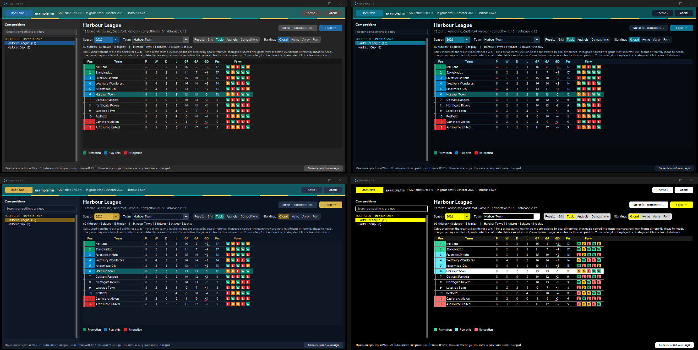
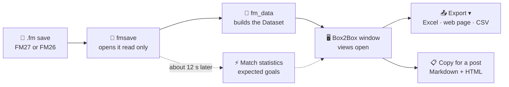
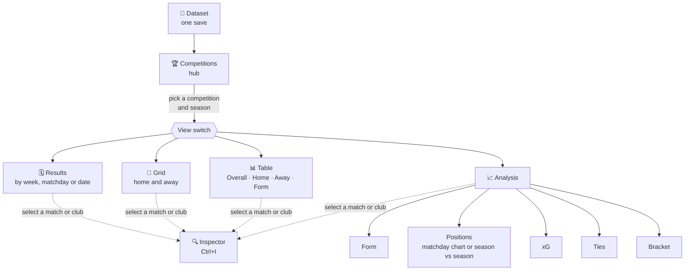
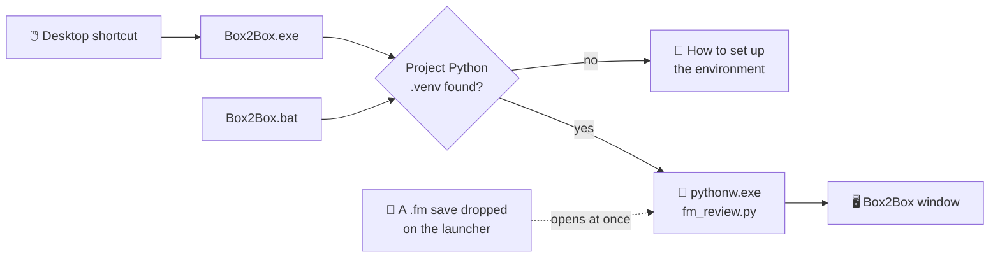
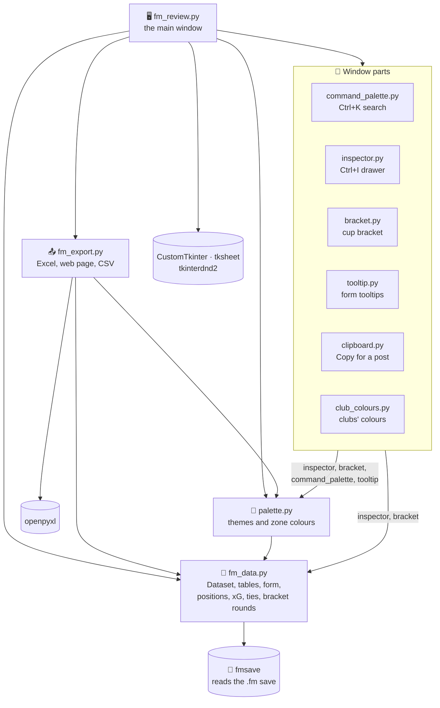

<div align="center">


# Box2Box

**Every fixture, result, table and cup tie in your Football Manager save, laid out like a broadcast and never changed.**

A Windows desktop viewer for the fixtures, results, grids and league tables in a Football Manager 27 (or 26) save. Saves are read with [fmsave](https://rhiever.github.io/fmsave/) and are never modified.

[](https://github.com/hawkers63/Box2Box/releases/latest)
[](https://www.microsoft.com/windows)
[](https://www.python.org/)
[](https://customtkinter.tomschimansky.com/)
[](https://rhiever.github.io/fmsave/)
[](#-tests)
[](LICENSE)

[](https://github.com/hawkers63/Box2Box/releases/latest)

**Database viewer** · entry point `fm_review.py` · launcher `Box2Box.bat`

**Release:** 1.6  
**Status:** Current version on `main`  
**Application on disk:** `fm_review.py` (VERSION 1.6), launched with `Box2Box.bat`

</div>

---

## 📑 Contents

- [Why Box2Box](#-why-box2box)
- [Key features](#-key-features)
- [Glimpse](#-glimpse)
- [Quick start](#-quick-start)
- [How a save reaches the screen](#-how-a-save-reaches-the-screen)
- [Keyboard and mouse](#%EF%B8%8F-keyboard-and-mouse)
- [Feature tour](#-feature-tour)
- [Themes and club colours](#-themes-and-club-colours)
- [Exports](#-exports)
- [Start Box2Box from the desktop](#%EF%B8%8F-start-box2box-from-the-desktop)
- [How it is built](#%EF%B8%8F-how-it-is-built)
- [Project layout](#-project-layout)
- [Tests](#-tests)
- [Release history](#-release-history)
- [Copyright and licence](#%EF%B8%8F-copyright-and-licence)

---

## ⚽ Why Box2Box

Football Manager keeps every fixture and result of every competition in your save, but the game shows them a screen at a time. Box2Box opens the save beside the game and lays the lot out at once: a home-and-away grid, tables with their zones, form and streaks, positions by matchday, expected goals, two-legged ties and a cup bracket.

> [!IMPORTANT]
> **Your save is only ever read.**
> - Box2Box opens the save with `fmsave` and **never writes to it**. The status bar says so on every save.
> - Where the save does not hold something, Box2Box says so: an unrecovered score reads **n/a** or **?**, a missing statistic reads **—**, and an estimated zone or an unfinished season is labelled.
> - Competition names, settings and exports are kept in files of their own, never in the save.

| Pillar | What you get |
| --- | --- |
| **Read only** | The save is opened, read and closed; nothing in it is ever changed |
| **Honest about gaps** | Coverage counts, "n/a" scores, "at least" runs and estimated zones are all spelt out |
| **Built for big saves** | A save opens in about half a minute, and its expected goals follow while you browse |
| **Yours to share** | Excel, a single web page, CSV files, or a table ready to paste into a forum post |

---

## ✨ Key features

| | |
| --- | --- |
| 🏆 **Competitions hub** | Every competition in the save, sorted into *Your Club*, *League*, *Cup*, *Youth / Reserves* and *Friendlies*, with entrants, fixtures and season progress |
| 🔲 **Fixture grid** | A high-contrast home-and-away matrix, coloured from the followed club's point of view |
| 📊 **League standings** | Broadcast-style zones from the save's own rules, and **Overall**, **Home**, **Away** and **Form** splits with W, D, L badges |
| 📈 **Analysis** | **Form**, **Positions** (matchday chart or season against season), **xG**, **Ties** and **Bracket** panels |
| 🏟️ **Cup bracket** | A knockout cup drawn as a tree of its last rounds, with aggregates, replays and the winner in bold |
| 🔍 **Inspector drawer** | **Ctrl+I**: a match's statistics and every meeting between the two clubs, or a club's form, record and next match |
| ⌨️ **Command palette** | **Ctrl+K** or **Ctrl+P**: jump to any competition, club, view, panel or action in a few keystrokes |
| 🖱️ **Right-click menu** | Follow either club, show only the meetings of two clubs, export or copy, from any row |
| 🗓️ **Weekly results** | Every match by week, matchday or date, with a club's campaign and running points |
| 🎨 **Themes and club colours** | Four themes, and the colours of the club you follow worked into the window |
| 📤 **Exports** | Excel workbook, standalone web page, CSV files, and **Copy for a post** for Reddit or the SI forums |
| 📂 **Drag and drop** | Drop a `.fm` save onto the launcher or the open window to open it |

---

## 📸 Glimpse

<p align="center">
  
  <br><sub><b>The Table view</b> on a made-up league of fictional clubs, in the Midnight Emerald theme.</sub>
</p>

<p align="center">
  
  <br><sub><b>The four themes</b>: Midnight Emerald, Cyber Pitch, Deep Slate &amp; Gold and High-Contrast.</sub>
</p>

<p align="center"><sub>Nothing in these pictures is read from a save: the league, the clubs and the followed club's colours were invented for them.</sub></p>

---

## 🚀 Quick start

The **standalone Windows build** is the quickest path: unzip the folder from the latest Release, then double-click `Box2Box.exe` inside it. Nothing to install: Python, the libraries and the app icon are bundled. Settings and the error log are written next to `Box2Box.exe`, so the folder is portable — put it on a USB stick or a different drive and it behaves the same. Windows SmartScreen may prompt the first time because the exe is not code-signed; pick **More info → Run anyway**.

From source, double-click the **Box2Box** shortcut on the desktop (see below) or **Box2Box.bat**, then **Open save…**. Saves live in `Documents\Sports Interactive\Football Manager 27\games`. Reading one takes around half a minute. The save opens as soon as it has been read; its expected goals follow about 12 seconds later, while you browse. You can also drag a `.fm` save file onto the launcher to open it straight away, or onto the open window to switch to it: one save at a time, and not while another is still being read. Dropping onto the window uses `tkinterdnd2` (installed from `requirements.txt`); without it the window works as before and says so.

From a terminal:

```powershell
.venv\Scripts\python fm_review.py ["path\to\save.fm"]
```

To set the environment up again:

```powershell
py -3.14 -m venv .venv
.venv\Scripts\python -m pip install -r requirements.txt
```

Python 3.12 or newer is required. This working tree uses Python 3.14 in `.venv`.

---

## 🔄 How a save reaches the screen



The save is read on a background thread, so the window stays responsive. Clubs, competitions, fixtures and results, league tables and competition rules come first; as soon as they are in, the views open. The match statistics behind expected goals take longest, so they are read last and added while you browse. Another save cannot be opened until they have arrived. A reader that fails on an unrecognised game build is noted in **Save details & warnings**, and everything else still opens.

### What you can look at



---

## ⌨️ Keyboard and mouse

| Keys or action | What it does |
| --- | --- |
| **Ctrl+K** or **Ctrl+P** | Open the command palette |
| **Up** / **Down**, **Enter** | Move through the palette's results, and go to the chosen one |
| **Ctrl+I** | Open or close the inspector drawer |
| **Esc** | Close the command palette or the inspector drawer |
| **Right-click** a row | Follow either club, **Show only** two clubs' meetings, export or copy |
| **Click** a team | Follow it (Table and Analysis) |
| **Double-click** a competition | Open it in the view you last used (Competitions hub) |
| **Hover** a W, D, L or ? badge | See that match in words |
| **Drop** a `.fm` file | Open it: onto `Box2Box.bat`, `Box2Box.exe` or the open window |

---

## 🧭 Feature tour

Open a feature for the full details.

<details>
<summary><b>🏆 Competitions hub</b></summary>

**Competitions hub.** Browse every competition in the save, classified into *Your Club*, *League*, *Cup*, *Youth / Reserves* and *Friendlies*. The hub shows entrants, fixture volume, matches played and season progress. Click a row to select that competition; double-click it, or pick it in the list on the left, to open it in the view you last used.

</details>

<details>
<summary><b>🔲 Fixture grid</b></summary>

**Fixture grid.** A high-contrast home-and-away matrix. When you follow a club, its row and column show results from that club's perspective (emerald for wins, amber for draws, crimson for defeats).

</details>

<details>
<summary><b>📊 League standings</b></summary>

**League standings.** Broadcast-style zone colours for promotion, play-offs and relegation, taken from the save's own competition rules where they can be matched — for example the Championship shows 1st–2nd promoted, 3rd–8th in the play-offs and 22nd–24th relegated. Where the rules cannot be matched (League One and League Two before their season starts), and for the Champions League and Europa League places of a 20-team top division, the zones are estimated from the league's size, and the note above the table says so. Zones are shown on the Overall table. Split the table instantly between **Overall**, **Home**, **Away** and **Form (last five matches)**. Form is drawn as coloured W, D, L and ? badges, each row has a strip down its left edge in its zone's colour, a colour key sits under the table, and a small bar under each goal difference shows how large it is. Hover a badge to see that match in words, for example "Won 2-1 v Leeds United, Sat 8 Aug"; the same works in the Analysis Form panel and the inspector. A table worked out from the results separates teams level on points as the competition's own rules list them, where results can settle it (wins first in MLS and Brazil, goal difference first in most leagues), and the note says which order it used.

</details>

<details>
<summary><b>📈 Analysis: Form, Positions and xG</b></summary>

**Analysis.** Three looks at a season, each stating how much of it the save covers:
- **Form:** every team's last five results, current run, points per game, totals (clean sheets and failures to score among them) and longest winning, unbeaten, winless and losing runs, with the season's records underneath. Click a team to follow it; its last five appear in words below the sheet. A played match whose score the save does not hold shows as **?**, counts in no total, and any run it touches reads "at least".
- **Positions:** each team's place after every matchday, worked out from the results and ranked within each of the game's tables (conferences and zones included), coloured by zone, and checked against the game's own table. For a league with at least two seasons in the save, a *Matchday chart* / *Season vs season* switch at the top of the panel flips to a side-by-side final standings table, newest season on the left, with a Δ Pos column showing the move since the previous season. Each column says *(final)* when every league match has a score and *(in progress, X of Y)* otherwise, and carries its own zone fill; a club absent from a season reads "—".
- **xG:** each team's expected goals for and against, from the match reports the save kept, beside its goals in the same matches. Over- and under-performance are green or red only where they average more than 0.25 goals a match. Missing values are left blank, never shown as 0.00.

</details>

<details>
<summary><b>🏟️ Cup bracket</b></summary>

**Cup bracket.** **Analysis → Bracket** draws a knockout cup as a tree of its last rounds (the final and up to three rounds before it): each tie shows both sides and their goals in each match, the winner in bold, and a line to the tie it fed; the earlier rounds are listed below. Two legs are decided on aggregate and a replay belongs to its tie. The save does not store extra time or penalties, so the winner of a drawn match is the side that plays in the next round, marked with a star. A competition that does not end in a single final says so and lists its rounds, and a group or league phase is counted, not drawn. The panel is for cups; a league says so.

</details>

<details>
<summary><b>🤝 Ties</b></summary>

**Ties.** In a competition with two-legged ties (the same two sides meeting twice in a round, home and away), **Analysis → Ties** lists each tie with both legs, the aggregate and where it stands, for example "Wrexham go through" or "Second leg to play". The save stores no away goals, extra time or penalties, so a level aggregate says it is not decided there. Elsewhere the panel says the competition has no two-legged ties. Rounds the save names (third round to final) keep their names; others read "Round 1", "Round 2".

</details>

<details>
<summary><b>🔢 Counts on the view switch</b></summary>

**Counts on the view switch.** In a window wide enough for them (about 1540 pixels), the switch shows how many matches are still to play in the competition and season (`Results (254)`), how many competitions the save holds (`Competitions (500)`), and the followed team's current run once it is three or longer (`Table (N11)`): **W** won in a row, **U** unbeaten, **N** without a win, **L** lost in a row, with a **+** when a match with no recoverable score could make the run longer. In a narrower window the switch shows plain names, so the counts never squeeze the controls beside it. The window itself cannot be made narrower than its controls need (about 1,410 pixels, or your screen's width if that is less).

</details>

<details>
<summary><b>⌨️ Command palette</b></summary>

**Command palette.** **Ctrl+K** or **Ctrl+P** opens a search box over the window; type a few letters, press **Enter**, and you are there. It finds competitions, clubs, the five views, the Table's splits, Results' groupings, the Analysis panels, and actions (exports, themes, **Open save…**, **About** and the like). Up and Down move, **Esc** closes. Clubs are those of the open competition plus every senior league and cup in the save, never youth, reserve or friendly competitions; a club opens in its main league and is followed. Matching ignores case and accents, and `utd` finds *United*.

</details>

<details>
<summary><b>🖱️ Right-click menu</b></summary>

**Right-click menu.** Right-click a row in Results, Grid, Table or Analysis to follow either club on it, to **Show only** the meetings of the two clubs in a match (a note and **Clear** button show while the filter is on), to open **Head-to-head** on the two clubs (from a Table, Analysis or Grid row that names only one club, the item reads **Head-to-head with {followed}** and uses the club you follow as the other side; it is greyed when no club is followed), to export, or to copy.

</details>

<details>
<summary><b>🔍 Inspector</b></summary>

**Inspector.** The **Inspector** button beside Export, or **Ctrl+I**, opens a drawer over the right edge of the sheet; the same button, **Ctrl+I**, **Esc** or its ✕ close it. It stays shut until you ask, follows whatever you select, and never takes the keyboard from the sheet. When its content is longer than the window, it scrolls with the mouse wheel. Select a match (a Results row or a Grid cell) to see its date, kick-off, round and status, the score, the statistics the save's match report holds (xG, shots, shots on target, possession, passes, corners, fouls and cards for each side), the followed club's last five results and run, and every meeting between the two clubs across every competition and season the save holds, grouped by competition and season. Select a club (a Table, Analysis or Grid row) to see its form, record, points per game, next match and expected goals. In the Competitions hub it describes the selected competition. A figure the save does not hold shows as **—**, never 0, and a match with no report says so.

</details>

<details>
<summary><b>📋 Copy for a post</b></summary>

**Copy for a post.** **Export ▾ → Copy for a post ▸** (or the command palette) copies the **Table**, **My club's results** (with your next match) or the **Recent results** (the latest round) as a table ready to paste into a Reddit or SI forums career update. One copy puts two versions on the clipboard: Markdown text, which Reddit's editor takes, and an HTML table, which a rich editor takes. Each ends with the in-game date and how complete the data is, and a match with no recoverable score reads "n/a". Zone and club colours are left out, because forums strip them.

</details>

<details>
<summary><b>🗓️ Weekly results and coverage</b></summary>

**Weekly results.** Every match in chronological order, grouped by calendar week (Monday start), matchday or date. Pick a club to view their campaign with W/D/L indicators and running points. Matches with a match report in the save show their expected goals (xG); click one for its xG scoreline, for example `Harbour Town [1.82] 2-1 [0.45] Mill Lane`.

**Coverage.** Transparent counts of played matches, matches still to play, and played matches with unrecovered scorelines ("n/a").

</details>

<details>
<summary><b>🏷️ Competition names</b></summary>

**Competition names.** Saves do not store competition names, so a competition first appears by its id and best-known clubs, for example `[8] West Ham, Wolves, Burnley`. Use **Name this competition…** to name it. Names go in `competition_names.csv` (`database_id,name`), keyed on the game's database id, so they apply to every save and can be edited in Excel. fmsave reads the same format.

</details>

---

## 🎨 Themes and club colours

**Theme ▾**, at the top right, changes the window's colours at once, and you stay where you are: the competition, season, team, view and scroll position do not move. Four themes come with Box2Box:

- **Midnight Emerald**, the original look and the default.
- **Cyber Pitch**: near-black surfaces with electric cyan.
- **Deep Slate & Gold**: broadcast slate with gold headings and controls.
- **High-Contrast**: white on black with yellow, where every coloured cell reads at 4.5:1 or better (the usual measure of readable text). It shows no club colours.

Your choice is remembered in `box2box_settings.json`.

The club you follow also lends its colours to the title band (with a stripe of both colours along its foot), the selected view and the followed team's highlight. They never replace a colour that carries meaning: results, zones and headings keep theirs, and a club colour is lightened or darkened until it can be read and stands apart from what surrounds it.

The colours come from a built-in list: every English league club, and the big sides of Spain, Germany, Italy, France, Portugal, the Netherlands, Scotland and Turkey. For another club, or to correct one, follow that club and choose **Theme ▾ → Club colours…**: pick its main and second colours with Windows' colour picker, or choose **No club colours**, or **Use the built-in colours** to undo a change. Your changes are kept in `box2box_settings.json`, which stays on your machine.

---

## 📤 Exports

**Export ▾** (next to *Name this competition…*) saves the competition and season you are looking at:

- **Excel workbook (.xlsx)**, with these sheets:
  - Table, with its zone colours.
  - Grid, coloured as in the app.
  - Results, grouped as on screen.
  - Your followed team's results, with running points.
  - About: where the data came from.
- **Web page (.html):** one file with the same sections and colours, plus a box to show one team's matches. It opens in any browser and needs nothing else, so it can be shared as it is.
- **CSV files (.csv):** Results, Table, Grid and About, in a folder of their own, for your own analysis. Scores are written with an en dash (2–1) so that Excel does not turn them into dates.

Exports are made in the colours the window has when you choose Export: its theme, and the colours of the club you follow if it has any. The workbook's sheets stay white, and CSV files are plain text.

Exports go to `Documents\Box2Box` (*Export ▾ → Open the export folder*), one per competition and season. Each is named after the competition, the season and the save's in-game date, for example `Harbour League 2026-27 (2026-10-03).xlsx`, so exporting the same save again replaces it while a later save gets a file of its own. Every export says which save it came from, how complete the data is, and whether the zones are the game's or estimated. If Excel has the workbook open, Box2Box leaves the old file alone and asks you to close it first.

---

## 🖥️ Start Box2Box from the desktop

There are two launchers, built with different tools, for different audiences.

**The standalone build** (`dist\Box2Box\Box2Box.exe`, built by `build_exe.ps1`) is a self-contained Windows folder. It bundles Python, CustomTkinter, tksheet, tkinterdnd2 (with its tkdnd native library), fmsave, openpyxl and the app icon — nothing else needs installing. Settings and the error log are written next to the exe, so the folder is portable. A save dragged onto `Box2Box.exe` opens straight away, and a save dragged onto the window works too. Build it once, from PowerShell in the Box2Box folder:

```powershell
.\.venv\Scripts\python -m pip install -r requirements-build.txt     # once per machine
.\build_exe.ps1                                                     # every rebuild
```

The output is `dist\Box2Box\` — about 64 MB with roughly 1,170 files. Zip that folder and move or share it. The exe is not code-signed; Windows SmartScreen will prompt the first time (pick **More info → Run anyway**).

**The C# launcher** (`Box2Box.exe` at the project root, built by `build_launcher.ps1`) is a small development wrapper that carries the Box2Box football icon and starts Box2Box through the project's own `.venv`. Build it once, from PowerShell in the Box2Box folder:

```powershell
.\build_launcher.ps1
```

This compiles `launcher\Box2Box.cs` with the C# compiler that comes with Windows, so nothing else needs installing. It writes `Box2Box.exe` next to `Box2Box.bat` and puts a **Box2Box** shortcut on the desktop; add `-NoShortcut` to leave the desktop alone. Keep the exe in the Box2Box folder and start it from the shortcut, because on its own it cannot find the app. It never needs rebuilding when Box2Box is updated, and `Box2Box.bat` still works as before.



---

## 🏗️ How it is built

`fm_review.py` is the window. Everything it shows comes from `fm_data.py`, a pure data layer with no user interface, so the views, the exports and the tests all work from the same figures.



---

## 🗂️ Project layout

| File | Purpose |
| --- | --- |
| `Box2Box.bat` | One-click launcher for the application |
| `build_launcher.ps1`, `launcher/Box2Box.cs` | Builds `Box2Box.exe`, the launcher with the icon, and its desktop shortcut |
| `icon/football-64-sky-blue.ico` | The Box2Box icon: windows, taskbar and launcher |
| `docs/images/` | The README's logo (`box2box-logo.svg`, and PNG copies) |
| `docs/screenshots/` | Pictures of the window on a made-up league |
| `fm_review.py` | The main Box2Box desktop application (CustomTkinter + tksheet) |
| `fm_data.py` | Pure data layer: parsing, grid matrices, standings, form, positions, expected goals and competition summaries |
| `fm_export.py` | Excel, web page and CSV exports of one competition and season |
| `palette.py` | The app's colour themes and how club colours are worked into them, shared by the window and the exports |
| `club_colours.py` | Football clubs' colours, for the followed club's tint |
| `command_palette.py` | The command palette: how a query finds and ranks items, and the overlay that shows them |
| `inspector.py` | The inspector drawer: what it can show, and the overlay that draws it |
| `tooltip.py` | The small tooltip shown over form badges |
| `bracket.py` | The cup bracket: where each tie's box goes (pure layout) and the canvas that draws it |
| `clipboard.py` | Puts text and an HTML table on the Windows clipboard together, for Copy for a post |
| `test_fm_data.py`, `test_fm_export.py`, `test_fm_review_ui.py`, `test_palette.py`, `test_club_colours.py`, `test_command_palette.py`, `test_inspector.py`, `test_tooltip.py`, `test_clipboard.py`, `test_bracket.py`, `test_probe.py` | Test suite |
| `requirements.txt` | Pinned Python dependencies |
| `LICENSE` | Proprietary All Rights Reserved licence |
| `CHANGELOG.md` | Release history |

`competition_names.csv` and `box2box_settings.json` are created on the machine when you first name a competition or open a save. They are local files and are not part of the public tree.

---

## 🧪 Tests

From the repository root, with the project environment:

```powershell
$env:QT_QPA_PLATFORM='offscreen'
.venv\Scripts\python.exe -m unittest discover -s . -p "test_*.py" -v
```

The same discovery command is:

```text
python -m unittest discover -s . -p "test_*.py" -v
```

The tests write only to temporary directories and do not need a real Football Manager save. They do not reflect a private save. The probe smoke test in `test_probe.py` is skipped when the private local tool `fm27_probe.py` is not present, so a fresh clone still passes.

---

## 📜 Release history

| Release | Date | Highlights |
| --- | --- | --- |
| [**1.6**](https://github.com/hawkers63/Box2Box/releases/tag/v1.6) | 17&nbsp;Nov&nbsp;2026 | 🏟️ The cup bracket, every meeting between two clubs in the inspector, and season against season in Positions |
| [**1.5**](https://github.com/hawkers63/Box2Box/releases/tag/v1.5) | 16&nbsp;Nov&nbsp;2026 | 📋 Copy for a post, the Ties panel, form tooltips and a scrolling inspector |
| [**1.4**](https://github.com/hawkers63/Box2Box/releases/tag/v1.4) | 16&nbsp;Nov&nbsp;2026 | ⌨️ Drop a save on the window, the command palette, the right-click menu and the inspector drawer |
| [**1.3**](https://github.com/hawkers63/Box2Box/releases/tag/v1.3) | 16&nbsp;Nov&nbsp;2026 | 🎨 Colour themes, club colours, form badges, and the icon with a launcher |
| [**1.2**](https://github.com/hawkers63/Box2Box/releases/tag/v1.2) | 15&nbsp;Nov&nbsp;2026 | 📈 The Analysis view: form, streaks, positions by matchday and expected goals |
| [**1.1**](https://github.com/hawkers63/Box2Box/releases/tag/v1.1) | 15&nbsp;Nov&nbsp;2026 | ©️ An About screen with the copyright and the terms of use |
| [**1.0**](https://github.com/hawkers63/Box2Box/releases/tag/v1.0) | 15&nbsp;Nov&nbsp;2026 | ⚽ First release: the hub, grid, standings, weekly results and exports |

Full notes for every release are in [CHANGELOG.md](CHANGELOG.md).

---

## ©️ Copyright and licence

Copyright (c) 2026 onwards Mark Hawksworth (hawkers63). All rights reserved.

Box2Box is proprietary software. Copying, distribution, modification, reverse engineering, sublicencing and commercial exploitation are prohibited without prior written consent. See [LICENSE](LICENSE) for the full terms.

The app shows the same notice: **About**, at the top right of the window, gives the version, the copyright notice and the full licence.

Canonical repository: <https://github.com/hawkers63/Box2Box>

Football Manager is a trademark of Sports Interactive Limited. Box2Box is a personal tool and is not affiliated with Sports Interactive or Sega.
